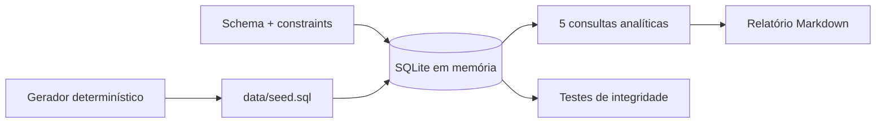
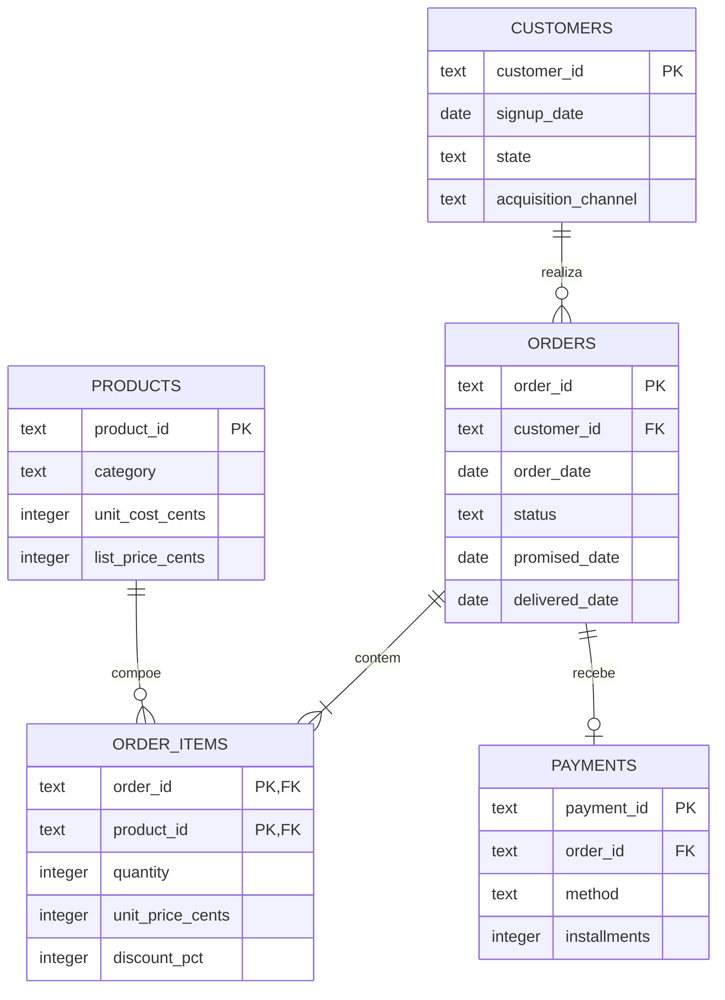

# SQL Commerce Lab

> Do dado bruto à pergunta de negócio: um laboratório reproduzível de SQL sobre um e-commerce 100% fictício.

[](https://github.com/matheuspalma91-beep/sql-commerce-lab/actions/workflows/ci.yml)
[](LICENSE)


## O problema

Uma análise útil não começa pelo gráfico: começa por uma pergunta que pode ser respondida e conferida. Este projeto simula a camada analítica de um pequeno e-commerce e organiza cinco perguntas recorrentes:

1. Como receita e ticket médio evoluem por mês?
2. Quais categorias têm melhor margem bruta?
3. Qual parcela dos clientes volta a comprar?
4. Onde o prazo de entrega mais falha?
5. Como a atividade muda nos primeiros meses de cada coorte?

Todos os registros são gerados localmente com uma seed fixa. Não há clientes, empresas ou números reais neste repositório.

## Resultado navegável

As consultas e suas saídas estão em [docs/results.md](docs/results.md). O relatório é recriado por `npm run report`; portanto, qualquer pessoa pode conferir a origem dos números.

Exemplo do conjunto fictício:

| dimensão | volume |
| --- | ---: |
| clientes | 200 |
| produtos | 30 |
| pedidos | 720 |

Os resultados demonstram as consultas, não conclusões sobre um negócio real. Por exemplo, a categoria `livros` apresenta a maior margem no dataset gerado, enquanto `MG` tem a maior taxa fictícia de atrasos.

## Arquitetura dos dados





O schema usa chaves estrangeiras, `CHECK` constraints e valores monetários em centavos. O runtime [`sql.js`](https://sql.js.org/) executa SQLite em memória, evitando exigir uma instalação nativa só para revisar o projeto.

## Estrutura

```text
data/          dataset SQL gerado e versionado
docs/          resultados reproduzíveis e decisões
lib/           carregamento do SQLite e execução das consultas
scripts/       geração, validação e relatório
sql/           schema e consultas numeradas
test/          integridade do dataset e regras analíticas
```

## Como executar

Pré-requisito: Node.js 22.13 ou superior.

```bash
git clone https://github.com/matheuspalma91-beep/sql-commerce-lab.git
cd sql-commerce-lab
npm ci
npm run check
npm run report
```

Para executar uma consulta isolada:

```bash
npm run query -- sql/01_monthly_revenue.sql
```

## Testes e qualidade

`npm run check` executa lint, confere se o dataset versionado é reproduzível e roda seis testes com o test runner nativo do Node. Os testes validam:

- volumes esperados do dataset;
- rejeição de pedidos com estados inconsistentes;
- datas limitadas ao período fictício documentado;
- execução das cinco consultas;
- conciliação entre pedidos entregues e receita reportada;
- igualdade entre o arquivo gerado e a seed fixa.

O CI repete essas verificações e bloqueia dependências com vulnerabilidades altas ou críticas.

## Decisões e trade-offs

### Por que dados fictícios?

Permitem publicar schema, consultas e resultados completos sem risco de expor uma organização. O custo é claro: os números não servem para inferência de mercado. A decisão está registrada em [ADR 0001](docs/decisions/0001-deterministic-fictional-data.md).

### Por que centavos em vez de `REAL`?

Valores inteiros evitam erros de ponto flutuante na persistência monetária. A conversão para reais acontece apenas na saída analítica.

### Por que SQL versionado em arquivos separados?

Cada pergunta pode ser revisada, testada e executada isoladamente. Isso preserva o raciocínio da análise e evita esconder regras em uma interface.

## Limitações e próximos passos

- [ ] adicionar testes explícitos de qualidade para datas e chaves órfãs;
- [ ] comparar uma consulta com window functions a sua alternativa compatível;
- [ ] exportar os resultados para CSV sem introduzir dados reais;
- [ ] criar uma pequena visualização somente depois de manter o SQL como fonte de verdade.

## Contribuindo

Veja [CONTRIBUTING.md](CONTRIBUTING.md). Relatos de segurança devem seguir [SECURITY.md](SECURITY.md), não uma issue pública.

## English summary

SQL Commerce Lab is a reproducible SQLite study built around five business questions. Its deterministic dataset is entirely fictional, while constraints, numbered queries, automated tests and generated results make every conclusion traceable.

## Licença

Código distribuído sob a [licença MIT](LICENSE). Perfil: [@matheuspalma91-beep](https://github.com/matheuspalma91-beep).

